<p align="center">
  
</p>

<p align="center">
  <a href="https://aeronjay.me"></a>
  <a href="https://www.linkedin.com/in/bulataoaeronjay/"></a>
  <a href="mailto:bulataoaeronjay@gmail.com"></a>
  
</p>

## Hey, I'm Aeron 👋

Software engineer from the Philippines who likes digging into how things actually work. I'm drawn to friction: if a workflow is clunky, repetitive or error-prone, I want to know why, and then I want to build the thing that makes it go away.

```kotlin
object Aeron {
    val from      = "Philippines 🇵🇭"
    val likes     = listOf("backends", "automation", "taking things apart")
    val tinkering = listOf("RAG pipelines", "vector search", "scrapers that don't break")
    val offline   = listOf("♟️ chess", "🎾 tennis", "🏋️ gym")
    val motto     = "Understand. Build. Break. Fix. Ship."
}
```

## A few things about me

- ♟️ Chess is how I unwind, and it's not that different from debugging: read the position, think a few moves ahead, then commit.
- 🎾 Tennis and lifting taught me that consistency beats intensity. It works for codebases too.
- 🤖 I built a chatbot whose best feature is saying "I don't know" when the documents don't cover the question.
- 🕷️ I've written scrapers for sites that really didn't want to be scraped. Selector fallback chains are my love language.
- 💬 Ask me about backend design, automating boring workflows, or which chess opening I'm currently ruining.

## Tools I reach for

<p>
  
  <br>
  
</p>

## GitHub activity

<p align="center">
  
  
</p>

<p align="center">
  
</p>

<picture>
  <source media="(prefers-color-scheme: dark)" srcset="https://raw.githubusercontent.com/aeronjay/aeronjay/output/snake-dark.svg">
  
</picture>

---

<p align="center">
  <sub>Building something interesting? Say hi at <a href="mailto:bulataoaeronjay@gmail.com">bulataoaeronjay@gmail.com</a> or poke around <a href="https://aeronjay.me">aeronjay.me</a>.</sub>
</p>
